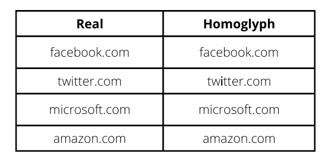
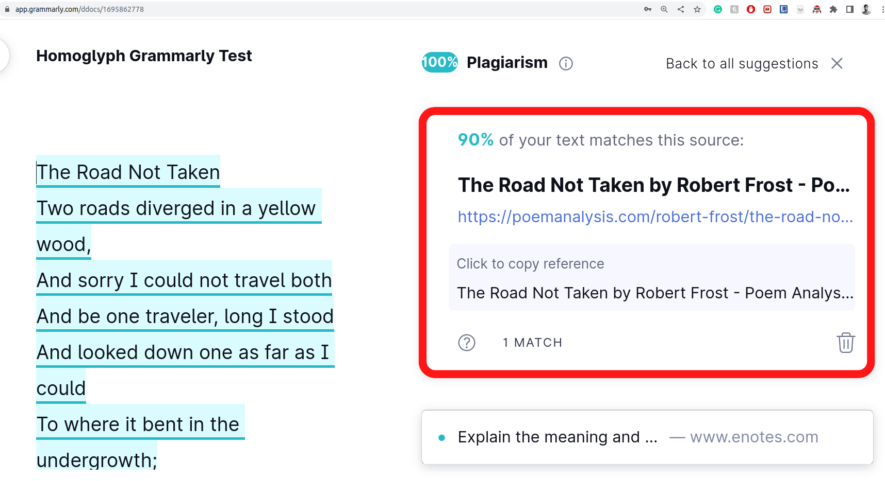
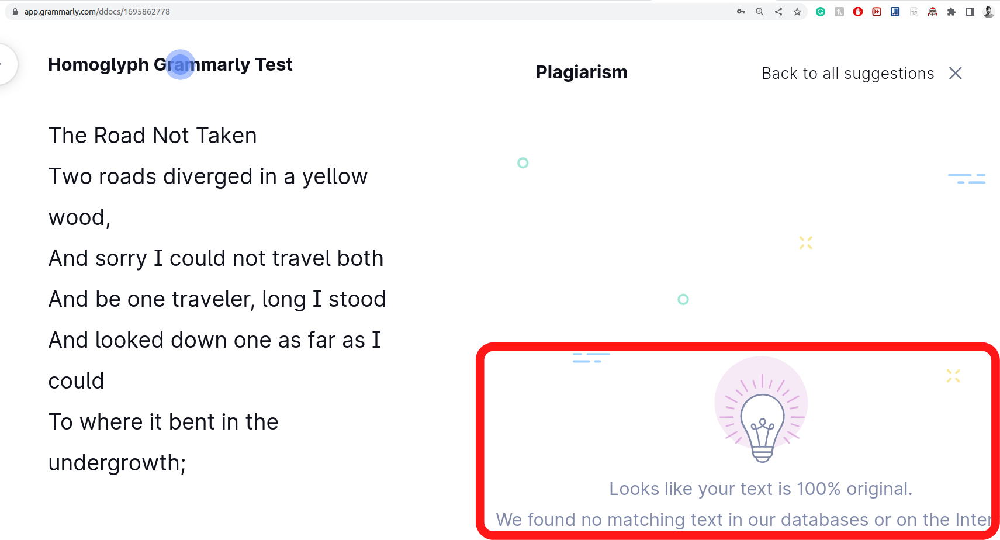
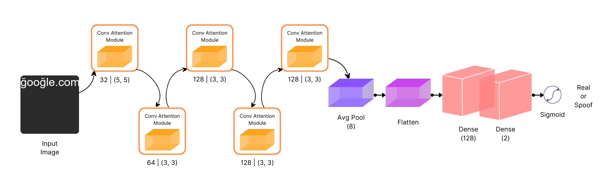
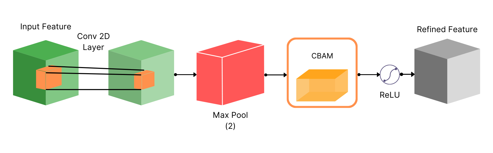

**[Paper](https://arxiv.org/abs/2306.10392) · [Code](https://github.com/Akshat4112/Glyphnet) · [Dataset](https://huggingface.co/datasets/Akshat4112/Glyphnet)**

**Authors:** Akshat Gupta, Laxman Singh Tomar, Ridhima Garg

## Research overview

GlyphNet studies visual detection of homoglyph domains using an attention-based CNN and a dataset of real and synthetically altered domain images. The paper reports 0.93 accuracy, F1 and AUC on its own test set. These results describe the paper experiment; the separately rendered public release is detailed under [Paper dataset and public release](#paper-dataset-and-public-release).

## Introduction

In cyber security, attackers employ different attacks to infiltrate our systems and networks, with the objective varying from stealing crucial information to inflicting system damage. One such deceptive attack is the homoglyph attack, which involves an attacker trying to fool humans and computer systems by using characters and symbols that may appear visually similar to characters used in real domain and process names but are different.





## Dataset

### Paper dataset and public release

The [paper](https://arxiv.org/html/2306.10392#S3) describes **4 million rendered images**: 2 million real domains and 2 million synthetic homoglyph domains, using Arial. Its Dataset and Experimentation sections specify **150 × 150 pixels**, while its [Discussion](https://arxiv.org/html/2306.10392#S7) says **256 × 256 pixels** gave the best results and was used. This inconsistency leaves the resolution used for the reported results ambiguous.

The separately rendered [public Hugging Face release](https://huggingface.co/datasets/Akshat4112/Glyphnet) contains **1,285,579 genuine/spoof domain pairs** in its `pairs` config and **2,571,158 images** in its `images` config (one real and one spoofed image per pair). These images are 256 × 256 pixels and use DejaVu Sans. The public release comes from the related generation pipeline but is not the identical set of paper image files; the paper's AUC should not be read as a new evaluation of the Hub release.

### Proposed Dataset

We have proposed a dataset consisting of real and homoglyph domains. We obtained domains from the Domains Project, comprising 500M domains, restricting our work to 2M domains due to hardware restrictions.

### Homoglyph Creation Algorithm

We created a novel algorithm for the generation of homoglyph domains to ensure that real homoglyphs are generated with randomness and closeness. To achieve this, we sample homoglyph noise characters using Gaussian sampling from the glyph pool.

### Image Generation

Homoglyph attacks exploit the weakness of human vision to differentiate real from homoglyph domain names. We rendered images from the real and homoglyph strings generated via our algorithm.

## Methodology

The CNN classifies one rendered domain image at a time. Four convolutional layers extract visual features, with max pooling and convolutional block attention modules that refine features across channel and spatial dimensions, as described in the [paper's Methodology section](https://arxiv.org/html/2306.10392#S4).




## Experimentation

### Dataset and Metrics

We split our dataset into train, validation, and test, with a ratio of 70:20:10, respectively. We use accuracy, precision, recall, and F1 score as our evaluation metrics, along with the AUC score.

### Experimental Settings

For training, we used binary cross-entropy loss and the RMSProp optimiser. The network was trained for 30 epochs with early stopping, using a batch size of 256.

## Results

The [paper's Table 2](https://arxiv.org/html/2306.10392#S4.T2) reports the following comparison on its dataset. The test set contains **400,000 images** from the 70:20:10 split; the Results section reports **372,000 correctly classified images** for the attention CNN.

| Architecture | Accuracy | F1 | AUC |
| --- | --- | --- | --- |
| Siamese CNN | 0.79 | 0.74 | 0.78 |
| Ensemble CNN | 0.83 | 0.80 | 0.83 |
| PhishGAN | 0.71 | 0.69 | 0.71 |
| Attention CNN (GlyphNet) | 0.93 | 0.93 | 0.93 |

This comparison is limited to the paper's dataset and experimental setup.

## Limitations

Synthetic homoglyphs and fixed rendering conditions limit conclusions about live phishing and other fonts. The paper's resolution ambiguity also limits reproducibility. The reported scores do not establish performance on the separately rendered Hugging Face release or in production; either setting requires its own evaluation. For the public release, follow its provided splits or group by `pair_id` to avoid leakage between near-identical pairs, as explained in the [dataset card](https://huggingface.co/datasets/Akshat4112/Glyphnet#intended-uses--limitations).

## References
1. Bahdanau, D.; Cho, K.; and Bengio, Y. 2014. Neural machine translation by jointly learning to align and translate. arXiv preprint arXiv:1409.0473.
2. Boor, V.; Overmars, M. H.; and Van Der Stappen, A. F. 1999. The Gaussian sampling strategy for probabilistic roadmap planners. In Proceedings 1999 IEEE International Conference on Robotics and Automation (Cat. No. 99CH36288C), volume 2, 1018–1023. IEEE.
3. Cheng, L.; Liu, F.; and Yao, D. 2017. Enterprise data breach: causes, challenges, prevention, and future directions. Wiley Interdisciplinary Reviews: Data Mining and Knowledge Discovery, 7(5): e1211.
4. Chollet, F.; et al. 2015. Keras. Damerau, F. J. 1964. A technique for computer detection and correction of spelling errors. Communications of the ACM, 7(3): 171–176.
5. Deng, J.; Dong, W.; Socher, R.; Li, L.-J.; Li, K.; and FeiFei, L. 2009. Imagenet: A large-scale hierarchical image database. In 2009 IEEE conference on computer vision and pattern recognition, 248–255. Ieee.
6. Ginsberg, A.; and Yu, C. 2018. Rapid homoglyph prediction and detection. In 2018 1st International Conference on Data Intelligence and Security (ICDIS), 17–23. IEEE.
7. Goodfellow, I.; Pouget-Abadie, J.; Mirza, M.; Xu, B.; Warde-Farley, D.; Ozair, S.; Courville, A.; and Bengio, Y. 2014. Generative adversarial nets. Advances in neural information processing systems, 27.
8. He, K.; Zhang, X.; Ren, S.; and Sun, J. 2016. Deep residual learning for image recognition. In Proceedings of the IEEE conference on computer vision and pattern recognition, 770–778.
9. Helms, M. M.; Ettkin, L. P.; and Morris, D. J. 2000. The risk of information compromise and approaches to prevention. The Journal of Strategic Information Systems, 9(1): 5–15.
10. Hoffer, E.; and Ailon, N. 2015. Deep metric learning using triplet network. In International workshop on similarity-based pattern recognition, 84–92. Springer.
11. Hong, J. 2012. The state of phishing attacks. Communications of the ACM, 55(1): 74–81.
12. Isola, P.; Zhu, J.-Y.; Zhou, T.; and Efros, A. A. 2017. Imageto-image translation with conditional adversarial networks. In Proceedings of the IEEE conference on computer vision and pattern recognition, 1125–1134.

## Citation
```bibtex
@article{gupta2023glyphnet,
  title={GlyphNet: Homoglyph domains dataset and detection using attention-based Convolutional Neural Networks},
  author={Gupta, Akshat and Tomar, Laxman Singh and Garg, Ridhima},
  journal={arXiv preprint arXiv:2306.10392},
  year={2023}
}
```
