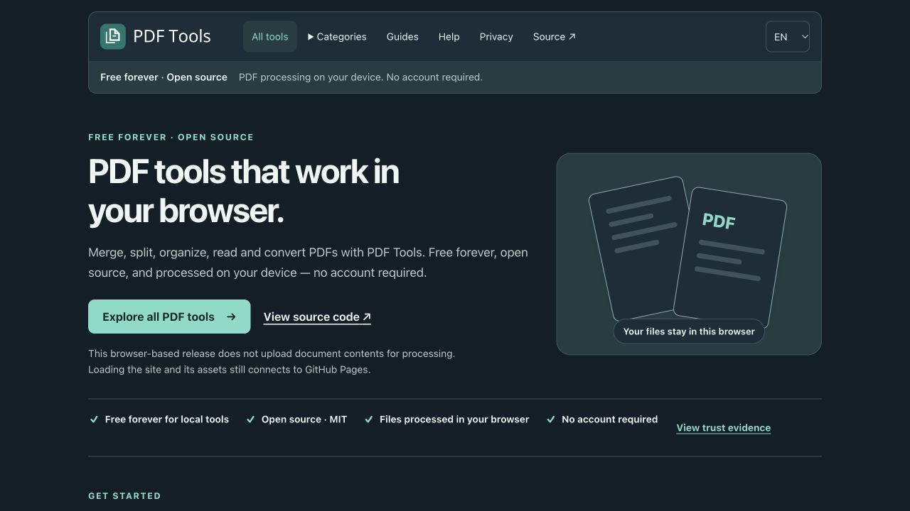

Ich arbeite an angewandter KI für Finanz- und Versicherungsanwendungen und entwickle öffentliche Werkzeuge und Forschungsprototypen.

## Angewandte KI

- **KI für Finanz- und Versicherungsdokumente** — Bei additiv entwickle ich Dokumenten-Workflows mit OCR, Retrieval, strukturierter Extraktion, Validierung und menschlicher Prüfung. [Berufserfahrung](/de/about/#berufserfahrung)
- **FinPlainLM** — Ein öffentlicher Präferenzdatensatz für verständliche Finanztexte mit Teilmengen für Supervised Fine-Tuning und Direct Preference Optimization. [Datensatzbeschreibung (Englisch)](https://huggingface.co/datasets/Akshat4112/finplainlm-dpo-dataset)

## Öffentliche Anwendungen

- **PDF Tools** — Eine Browser-Anwendung für PDF-Aufgaben, die ausgewählte Dokumente lokal verarbeitet. Zum Laden der Anwendung wird weiterhin GitHub Pages kontaktiert. [Anwendung öffnen](https://akshat4112.github.io/pdf-tools/) · [Quellcode](https://github.com/Akshat4112/pdf-tools) · [Fallstudie zur Exportprüfung (Englisch)](/posts/pdf-tools-output-validation/)
- **ImmoPilot DE** — Szenarien für Immobilienkauf und Finanzierung in Deutschland untersuchen und vergleichen. [Anwendung öffnen](https://akshat4112.github.io/immopilot-de/) · [Quellcode](https://github.com/Akshat4112/immopilot-de)
- **NettoPilot DE** — Ein Projekt zur Gehaltsberechnung und zum Vergleich von Stellenangeboten in Deutschland. [Anwendung öffnen](https://akshat4112.github.io/nettopilot-de/) · [Quellcode](https://github.com/Akshat4112/nettopilot-de)

## Forschung und Prototypen

- **GlyphNet** — Forschungsarbeit zur Erkennung täuschend ähnlicher Phishing-Domains anhand gerenderter Texte. [Projektseite (Englisch)](https://akshat4112.github.io/Glyphnet/) · [Paper](https://arxiv.org/abs/2306.10392) · [Code](https://github.com/Akshat4112/Glyphnet) · [Öffentlicher Datensatz](https://huggingface.co/datasets/Akshat4112/Glyphnet)
- **SpeakerDiff** — Ein Forschungsprototyp zur Stimmanonymisierung mit Sprecher-Embeddings aus Diffusionsmodellen. Der Schutz der Identität muss noch für das gesamte Konvertierungssystem evaluiert werden. [Code und Experimente](https://github.com/Akshat4112/speaker-diffusion) · [Artikel zur Stimmanonymisierung (Englisch)](/posts/speaker-anonymization/)

## Weitere Open-Source-Projekte

- [Machine Learning Case Studies](https://github.com/Akshat4112/machine-learning-case-studies) — Notebooks zu NLP, Computer Vision und klassischem maschinellem Lernen.
- [Awesome NLP Resources](https://github.com/Akshat4112/Awesome-NLP-Resources) — Eine kuratierte NLP-Leseliste.
- [Research Paper Presentations](https://github.com/Akshat4112/research-paper-presentations) — Folien zu Forschungspapern.

[Alle Repositories ansehen](https://github.com/Akshat4112?tab=repositories)
