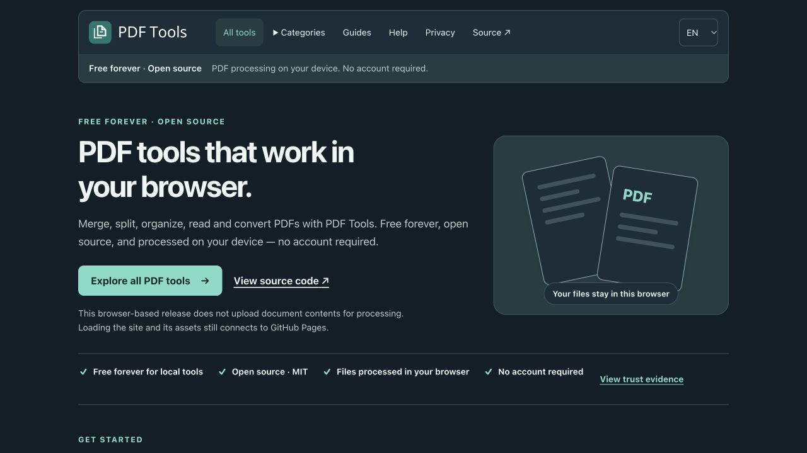

I work on applied AI in finance and insurance and build tools and research prototypes in public. The [homepage](/#work) has a short selection; this page is the fuller index.

## Applied AI

- **Document AI for finance and insurance** — At additiv I build document workflows with OCR, retrieval, structured extraction, validation and human review. [Professional experience](/about/#experience)
- **FinPlainLM** — A public preference dataset for financial plain-language explanations with supervised fine-tuning and direct preference optimisation splits. [Dataset card](https://huggingface.co/datasets/Akshat4112/finplainlm-dpo-dataset)

## Public applications

- **PDF Tools** — A browser application for PDF tasks that processes selected documents on the device. Loading the application still connects to GitHub Pages. [Open the app](https://akshat4112.github.io/pdf-tools/) · [Source code](https://github.com/Akshat4112/pdf-tools) · [Export-validation case study](/posts/pdf-tools-output-validation/)
- **ImmoPilot DE** — Explore and compare property-purchase and financing scenarios in Germany. [Open the app](https://akshat4112.github.io/immopilot-de/) · [Source code](https://github.com/Akshat4112/immopilot-de)
- **NettoPilot DE** — A German salary calculator and job-offer comparison project. [Open the app](https://akshat4112.github.io/nettopilot-de/) · [Source code](https://github.com/Akshat4112/nettopilot-de)

## Research and prototypes

- **GlyphNet** — Co-authored research on detecting lookalike phishing domains from rendered text. [Project page](https://akshat4112.github.io/Glyphnet/) · [Paper](https://arxiv.org/abs/2306.10392) · [Code](https://github.com/Akshat4112/Glyphnet) · [Public dataset](https://huggingface.co/datasets/Akshat4112/Glyphnet)
- **SpeakerDiff** — A research prototype exploring diffusion-generated speaker embeddings for voice anonymisation. The full conversion pipeline still needs privacy evaluation. [Code and experiments](https://github.com/Akshat4112/speaker-diffusion) · [Writing on speaker anonymisation](/posts/speaker-anonymization/)

## More open-source work

- [Machine Learning Case Studies](https://github.com/Akshat4112/machine-learning-case-studies) — Notebooks covering NLP, computer vision and classical ML.
- [Awesome NLP Resources](https://github.com/Akshat4112/Awesome-NLP-Resources) — A curated NLP reading list.
- [Research Paper Presentations](https://github.com/Akshat4112/research-paper-presentations) — Slide walkthroughs of research papers.

[Browse all repositories](https://github.com/Akshat4112?tab=repositories)
